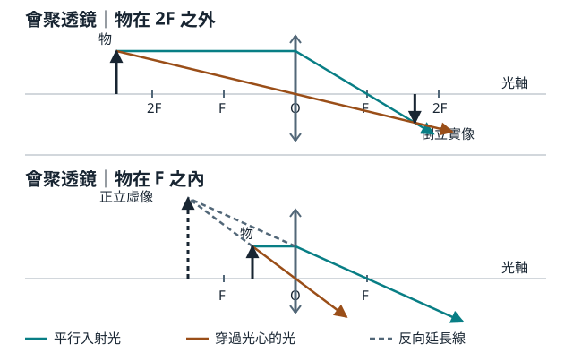

# 選修物理 III｜第 3 章 光的折射及其應用

翰林版 · 零基礎筆記

為什麼筷子泡在水裡像折斷了？為什麼光可以沿著光纖走？為什麼同一片放大鏡，有時看到正立大像，有時又能在紙上投出倒立像？這些問題都從同一件事開始：**光遇到介質的交界時，傳播方向可能改變。**

學習順序：**預備課 → 3-1 先會判斷光往哪裡彎 → 3-2 判斷光能不能出去 → 3-3 看不同顏色怎麼分開 → 3-4 用兩條光線找像。**

## 預備課：先看懂一張光線圖

- **介質**：光正在通過的材料，例如空氣、水、玻璃。
- **界面**：兩種介質的交界，例如水面。
- **光線**：用帶箭頭的線表示光的傳播方向。同一均勻介質中，幾何光學把光線畫成直線。
- **法線**：在光線打到界面的那一點，畫一條**垂直界面**的輔助線。題目的入射角、反射角、折射角，通常都從法線量。

~~~text
 入射光                 反射光
       ↘     │     ↗
         ╲ i │ r ╱      上方：介質 1
─────────────●───────────── 界面
             │╲ t
             │ ↘        下方：介質 2
             │  折射光
            法線
~~~

`i` 是入射光與法線的夾角，`r` 是反射光與法線的夾角，`t` 是折射光與法線的夾角（示意，不按比例）。**反射回到原介質，且 r = i；折射進入另一介質，t 要用折射定律求。** 有折射光時通常也可以有反射光。若題目說光線「與水面夾 30°」，則入射角是 60°；垂直打到水面才是 0°。

### 接回第一章：波速、頻率、波長

`v = fλ`。v 是波速，f 是每秒振動次數，λ 是相鄰兩個同相位波峰間的距離。光也有波長和頻率。光遇到**靜止界面**而折射時，兩側振動要跟上同一節奏，因此**頻率不變**；介質使波速改變，波長就跟著改變。到第 3-4 節時，透鏡公式也會用字母 f，但那裡的 f 是**焦距**，單位是長度。

## 3-1 光的折射與司乃耳定律

### 先判方向，再算角度

折射率 **n = c/v**。c 是真空光速，約 3.00 × 10⁸ m/s；v 是光在介質中的速率。n 沒有單位。高中題常取空氣 n ≈ 1.00、水 n ≈ 1.33、普通玻璃 n ≈ 1.50，計算以題目給值為準。**同一頻率下，n 越大，光走得越慢、波長越短。** 光密、光疏是比較折射率，不是比較質量密度。

**司乃耳定律：n₁ sin i = n₂ sin t**。下標 1 是光**來自**的介質，2 是光**進入**的介質，與圖畫在上方還是下方無關。

| 斜射方向 | 折射角 | 怎麼畫 |
|---|---|---|
| 小 n → 大 n（例如空氣進水） | t < i | 朝法線靠近 |
| 大 n → 小 n，且有折射光 | t > i | 離法線遠一些 |
| 正入射 i = 0° | t = 0° | 直走；若 n 改變，速率與波長仍會改變 |

從第一章的惠更斯原理想：一排波前斜碰界面，一端先進入慢速介質，前進距離先縮短；另一端還在原介質走得較快。兩端走的距離不一樣，波前就轉向。**光線垂直波前**，所以也轉向。若整排波前同時進入新介質，速度仍改變，但不會有哪一側先變慢，方向也不改變。

### 例題 1｜空氣射入玻璃

空氣 n₁ = 1.00、玻璃 n₂ = 1.50，入射角 45°。求折射角和玻璃中的光速。若真空波長為 600 nm，玻璃中的波長又是多少？

1. 先預測：由小 n 進大 n，t 應小於 45°。
2. 代入：sin t = (1.00/1.50)sin 45° ≈ 0.471，取反正弦得 **t ≈ 28.1°**。計算機用角度模式。
3. v = c/n = **2.00 × 10⁸ m/s**。頻率不變，波長按速率比例縮短：600 ÷ 1.50 = **400 nm**。這束光的頻率沒有變成另一種顏色的頻率。

### 例題 2｜魚為什麼看起來比較淺？

魚發出的光由水進空氣，折射後離法線更遠。眼睛接收到光時，會把到達眼睛的光線**反向直線延長**；延長線在魚的上方相交附近，因此看到較淺的**虛像**。由空氣近乎垂直往平水面看，視深 ≈ 真深 × n空氣/n水。水取 4/3，真深 1.20 m，則視深 ≈ **0.90 m**。

為什麼只限小角度？設光出水處離魚正上方的水平距離是 x，水中和空氣中相對法線的角分別為 i、t，則真深 = x/tan i、視深 = x/tan t。只有在 i、t 都小時，才好用 tan θ ≈ sin θ 配合司乃耳定律得到上述比值。**斜得很多時不能直接套近似。**

### 常考應用｜平行玻璃板

若玻璃板兩面平行、板的兩側都是空氣，光穿過第一面朝法線偏，穿過第二面離法線偏。兩面的法線平行，將司乃耳定律各寫一次，中間的 n玻璃 sin t 會消掉，所以**出射光與入射光平行**；斜射時通常會**側向位移**。正入射沒有側移。若兩面不平行，例如三稜鏡，就不能直接套「出射平行」。

## 3-2 光的全反射

光從大 n 走向小 n 時，折射角比入射角大。逐漸把入射角加大，折射光最後會沿界面走，此時折射角為 90°，對應的入射角叫**臨界角 θc**。

由 n₁ sin θc = n₂ sin 90°，得到 **sin θc = n₂/n₁**，前提是 **n₁ > n₂**。

| 入射角 | 發生什麼事？ |
|---|---|
| i < θc | 有折射光，也可有反射光 |
| i = θc | 折射光方向到達界面方向，t = 90°，是臨界情況 |
| i > θc | 理想界面發生全反射，沒有進入第二介質傳播的折射光 |

**全反射要同時符合：從大 n 射向小 n，而且 i > θc。** 如果算出 sin t > 1，先確認介質編號與量角方向；若都正確，就是沒有一般的折射角，不要拿計算機硬算反正弦。

### 例題 3｜同一塊玻璃，40° 和 45° 有什麼不同？

玻璃 n₁ = 1.50，空氣 n₂ = 1.00。θc = sin⁻¹(1.00/1.50) ≈ **41.8°**。玻璃射向空氣時，40° 小於臨界角，仍有折射光；45° 大於臨界角，發生全反射。若把方向反過來，從空氣射向玻璃，則 **45° 不會全反射**。

### 應用｜光纖、稜鏡與水面

- **光纖**：纖芯折射率大於包層。適當角度入射的光，在纖芯與包層的界面反覆全反射而被導引。比較的是**光打到側壁時和側壁法線的夾角**，不是和光纖軸的夾角。光纖彎得太急時，部分光可能不再符合條件而漏出。
- **直角稜鏡**：光若垂直進入一個直角面，射到斜面時的入射角可為 45°；對 n = 1.50、外面是空氣的稜鏡，45° > 41.8°，可用全反射轉向。
- **從水下看水面**：水射向空氣的臨界角約 48.6°（水取 n = 4/3）。超過此角的水中光線在水面全反射，所以斜看水面時可能像在看鏡子。

**進階一步｜多層平行介質。** 如果光每一面都能穿過，平行的界面使各層的 n sin θ 相同。例：從 n = 1.60 的第一層以 45° 射入 n = 1.40 的第二層，接著遇到空氣 n = 1.00。這束光的 n sin θ = 1.60 sin 45° ≈ 1.13。因 1.13 < 1.40，第一面能折射；到第二面若要進空氣，就需要 sin θ空氣 = 1.13 > 1，因此在**第二面**全反射。逐面判斷，不能跳過第一面。

## 3-3 光的色散與彩虹成因

### 白光不是一個頻率

白光包含許多不同頻率。普通玻璃在可見光範圍通常對紫光的折射率較大，對紅光較小。以相同角度從空氣斜射入玻璃，**紫光的折射角比紅光小**，也就是紫光較靠法線。注意「折射角」是相對法線量的角，「偏折程度」是和原本前進方向的差；兩者不是同一個角。

光通過三稜鏡時，兩個面不平行，不同色光出射方向分開。一般的三稜鏡色散圖裡，色光整體偏向稜鏡底邊，紫光總偏折比紅光大。稜鏡是**把原本混在一起的光分開**，沒有把紅光變成紫光。普通玻璃中，紫光 n 較大、速率較小；在真空中紅光與紫光的速率都等於 c。

### 彩虹｜為什麼要背對太陽？

~~~text
背後的太陽 → 陽光射入前方水滴
                         ↓ 入滴折射、各色分開
                         ↓ 水滴內反射
你的眼睛   ← 光離開水滴時再折射
~~~

形成主要彩虹的光路可以記成「**折射 → 滴內反射一次 → 折射**」。其中的滴內反射不必是全反射；不要看到「反射」就自動套第 3-2 節。不同顏色以不同方向集中射出，眼睛從不同位置的水滴接收到不同色光，才看見弧形的色帶。

| | 主虹 | 副虹（霓） |
|---|---|---|
| 滴內反射次數 | 1 次 | 2 次 |
| 色序（外 → 內） | 紅 → 紫 | 紫 → 紅 |
| 位置與亮度 | 內側，通常較亮 | 外側，通常較暗 |
| 相對反太陽方向的典型角半徑 | 約 40°～42° | 約 51°～54° |

「反太陽方向」是從眼睛朝與太陽相反的方向，不是地平線。因為能把同色光送到眼睛的水滴分布在繞這條方向的圓錐上，彩虹看起來是弧；理想情況可成圓，地面通常遮住下半部。

### 例題 4｜看到兩道彩虹，外面那道的外側是什麼色？

外面那道是**副虹**。副虹是兩次滴內反射，色序與主虹相反，因此**外紫內紅**。兩道虹彼此較靠近的邊，在典型色序下都是紅色。

## 3-4 薄透鏡成像與應用

### 先分清楚：光有沒有真的會合？

- **實像**：透鏡後的光線真的在一個位置會合，可在該位置用屏幕接到像。
- **虛像**：透鏡後的光線沒有在像的位置會合，只有把出射光往回延長才相交。眼睛仍可看到虛像，但把屏幕放在虛像位置接不到它。
- **光軸**：穿過透鏡中心的基準線。**焦點 F**：平行光經會聚透鏡後聚在一處；對發散透鏡而言，出射光的反向延長線像從焦點發出。中心到焦點的距離大小為焦距的絕對值。兩側為同一介質時，可在中心兩側各標一個焦點。

普通玻璃放在空氣中，中央較厚的凸透鏡通常**會聚**，中央較薄的凹透鏡通常**發散**。本節假設薄透鏡、兩側為同一介質，並採近軸光線模型；判斷會聚或發散也取決於透鏡與周圍介質的折射率，不能把「凸必會聚」套到任何材料組合。

### 畫圖：從物體頂端挑兩條光線就夠

先畫光軸、透鏡中心 O、兩側的 F，再在左邊畫直立物體箭頭。以下以光由左往右為例。

| 從物體頂端出發的光 | 會聚透鏡 | 發散透鏡 |
|---|---|---|
| 入射光平行光軸 | 出射後通過右焦點 | 出射後發散，往回延長通過左焦點 |
| 通過中心 O | 近似直行 | 近似直行 |
| 與焦點共線的入射光 | 入射直線通過左焦點（可用延長線），出射平行光軸 | 入射方向指向右焦點，出射平行光軸 |

真正的出射光相交，就在交點畫實像箭頭尖；若不相交，往回延長出射光找交點，再畫虛像。兩條線足以定位，第三條可用來驗算。

上圖的交點在透鏡右側、光軸下方，所以是倒立實像；下圖的兩條實線在右側越走越分開，沿虛線往回找才在左側光軸上方相交，所以是正立虛像。圖中的實線是光實際走過的路，虛線只用來定位。

### 計算：用符號讀出像的性質

**1/f = 1/p + 1/q**，**m = h像/h物 = −q/p**。p 是物距，q 是像距，m 是橫向放大率。統一用 cm 或 m；三個距離都從薄透鏡中心量。以下只討論左邊的真實物體，故 p > 0。

| 符號 | 物理意思 |
|---|---|
| f > 0 / f < 0 | 會聚／發散透鏡 |
| q > 0 / q < 0 | 實像在透鏡另一側／虛像在物體同側 |
| m > 0 / m < 0 | 正立／倒立 |
| 絕對值 &#124;m&#124; > 1 / = 1 / < 1 | 放大／等大／縮小 |

### 會聚透鏡成像一覽

| 物體位置 | 像的位置 | 像的性質 |
|---|---|---|
| p > 2f | 另一側，f < q < 2f | 倒立縮小實像 |
| p = 2f | 另一側，q = 2f | 倒立等大實像 |
| f < p < 2f | 另一側，q > 2f | 倒立放大實像 |
| p = f | 出射光對同一物點彼此平行 | 沒有有限距離的像 |
| 0 < p < f | 同側，q < 0 | 正立放大虛像 |

發散透鏡面對真實物體時，像在**物體同側、透鏡與近端焦點之間**，是**正立縮小虛像**。會聚透鏡也可以成虛像，所以「虛像＝凹透鏡」是錯的。

### 例題 5～7｜同樣代公式，三種像

**例 5：會聚透鏡 f = +10 cm，物距 p = 15 cm。** 
1/q = 1/10 − 1/15 = 1/30，所以 q = +30 cm；m = −30/15 = −2。答案：另一側 30 cm，**倒立、放大 2 倍的實像**。驗算：物在 f 與 2f 之間，像應在 2f 之外。

**例 6：同一片透鏡，物距縮到 p = 6 cm。** 
1/q = 1/10 − 1/6 = −1/15，所以 q = −15 cm；m = −(−15)/6 = +2.5。答案：物體同側 15 cm，**正立、放大 2.5 倍的虛像**。這就是把字放在放大鏡焦距內的情況。

**例 7：發散透鏡 f = −12 cm，物距 p = 24 cm。** 
1/q = −1/12 − 1/24 = −1/8，所以 q = −8 cm；m = +1/3。答案：物體同側 8 cm，**正立、縮小的虛像**。

### 把生活用品翻譯成物距和像距

| 裝置 | 用到哪種成像？ |
|---|---|
| 相機 | 拍一般遠物時，鏡頭把光會聚到感光元件，形成倒立縮小實像；極遠物的像距接近焦距。 |
| 投影機 | 把投影片或顯示物面放在 f 與 2f 之間，屏幕接到放大的實像。 |
| 放大鏡 | 物在焦距內，眼睛看到正立放大虛像；這裡的 m 是橫向放大率，與儀器常標的視角倍率是不同量。 |
| 眼睛與眼鏡 | 正常眼在視網膜形成實像；近視看遠時像容易落在視網膜前，以發散鏡片矯正；遠視在調節不足時像傾向落在視網膜後，以會聚鏡片矯正。 |

## 考前速查：拿到題目先做哪一步？

| 看到題目給什麼 | 第一步 | 常見失分 |
|---|---|---|
| 折射率、角度、兩種介質 | 標界面、法線、光的行進方向，再列 n₁ sin i = n₂ sin t | 把與界面的夾角直接當入射角 |
| 光由高 n 到低 n | 先算或比較 θc，再決定能否求 t | 忘了臨界角本身是入射角；等於 θc 是臨界情況 |
| 彩虹、白光、稜鏡 | 分清折射率、偏折程度、觀察角三個量 | 看到主虹的外紅就以為紅光偏折比紫光大 |
| 透鏡焦距、物距 | 先標 f 的正負，再用 1/q = 1/f − 1/p | q 的負號不是距離大小為負，而是指像在物體同側 |

## 自我檢查｜先答再往下看

1. 雷射與水面夾 37°，入射角是多少？
2. 同一束光由空氣正射入玻璃，方向、頻率、波速、波長各如何變化？
3. 光在空氣入射某介質時，i = 45°、t = 30°。該介質的 n 約是多少？
4. 光穿過兩面平行、兩側都在空氣的玻璃板，斜射出來後方向和位置有何改變？
5. 光由 n = 1.60 的介質進入 n = 1.20 的介質。臨界角約多少？i = 50° 時有折射光嗎？
6. 上題若將光的行進方向改為由 n = 1.20 射向 n = 1.60，i = 50° 會全反射嗎？
7. 一束白光斜射入普通玻璃，紅、紫何者折射角小？何者在玻璃中較慢？
8. 一道虹外紫內紅、比旁邊的虹暗，這是哪種虹？形成它的光在水滴內反射幾次？
9. 會聚透鏡 f = 12 cm、p = 36 cm。求 q、m，並說明像的性質。
10. 會聚透鏡 f = 12 cm、p = 8 cm。同樣求 q、m，能否在像的位置用屏幕接到它？
11. 一片會聚透鏡原本在白紙上形成清楚的實像。遮住透鏡上半部，理想情況下像會缺一半嗎？
12. 會聚透鏡 f = 10 cm。若要在屏幕上接到像高為物高 2 倍的像，物體和屏幕各應離透鏡多遠？

### 參考答案與理由

1. **53°**。從法線量，所以 90° − 37°。
2. **方向不變、頻率不變、波速降低、波長縮短**。正入射不偏折；頻率維持，由 v = fλ 知 λ 隨 v 降低。
3. **約 1.41**。n = sin 45°/sin 30° ≈ 0.707/0.500。
4. **方向相同、光線側移**。板兩面的折射抵消了方向差，不能消除斜射時走過的橫向位移。
5. **約 48.6°；沒有**。θc = sin⁻¹(1.20/1.60)；50° > θc，所以全反射。
6. **不會**。從小 n 往大 n 不滿足全反射的第一個條件。
7. **紫光折射角較小，也較慢**。紫光的 n 較大，sin t 與 v 都較小。
8. **副虹，反射 2 次**。副虹在主虹外，顏色次序相反。
9. **q = +18 cm，m = −0.5**。因 1/q = 1/12 − 1/36 = 1/18，是另一側倒立縮小的實像。
10. **q = −24 cm，m = +3；不能**。因 1/q = 1/12 − 1/8 = −1/24，是物體同側正立放大的虛像。
11. **不會，通常是整幅像變暗**。物體各點的光能通過透鏡不同部位；遮掉一部分會減少能到達各像點的光。
12. **p = 15 cm、q = 30 cm**。屏幕接到的是實像，因此 q > 0；像高是 2 倍，q = 2p。代入 1/10 = 1/p + 1/(2p)，解得 p = 15 cm。

## 參考資料

- 範圍：[翰林出版・普高物理教材簡介](https://website.hle.com.tw/market/sh/%E8%A1%8C%E9%8A%B7%E7%AB%99/112/%E7%89%A9%E7%90%86/%E6%95%99%E6%9D%90%E7%B0%A1%E4%BB%8B/112%E7%BF%B0%E6%9E%97%E6%99%AE%E9%AB%98%E6%95%99%E6%9D%90%E7%B0%A1-%E7%89%A9%E7%90%86.pdf)、[翰林版第三章目錄・均一教育平台](https://www.junyiacademy.org/topics/h12a-physics-unit3)。
- 觀念核對：OpenStax [折射](https://openstax.org/books/university-physics-volume-3/pages/1-3-refraction)、[全反射](https://openstax.org/books/university-physics-volume-3/pages/1-4-total-internal-reflection)、[色散](https://openstax.org/books/university-physics-volume-3/pages/1-5-dispersion)、[薄透鏡](https://openstax.org/books/university-physics-volume-3/pages/2-4-thin-lenses)，以及美國國家氣象局 [彩虹成因](https://www.weather.gov/fgz/Rainbow)。
- 編排參考：[先前的波動筆記](https://github.com/jimmy980821-ops/wave-notes/blob/main/README.md)。本篇依公開章節範圍重新講解，例題及自測為自編。
